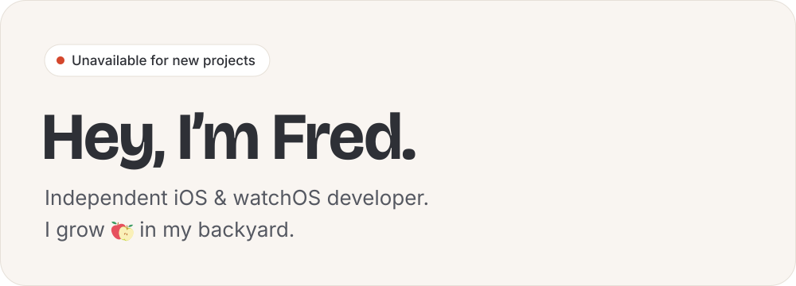

<a href="https://ephread.com">
	<picture>
		<source media="(prefers-color-scheme: dark)" srcset="media/header-unavailable-dark.svg">
		
	</picture>
</a>

I'm an independent iOS & watchOS developer in Montréal. I help companies build amazing apps, from designing the user interface to publishing them on the App Store. I've been doing it for more than a decade, in Swift and Objective-C.

Curious about what I've built? **[Have a look at my work →][ephread.com]**

### Open source things you may want to check out

#### iOS & watchOS
* **[Instructions]**, a pure Swift library to display coach marks. I originally wrote _Instructions_ in Objective-C, as part of another project. In 2015, I extracted the library and rewrote it in Swift.
* **[The Bell]**, a watchOS app designed for high-intensity interval workouts, first developed in 2020 and rebuilt in 2023 from the bottom up using SwiftUI.

#### ink
* **[inkjs]**, a JavaScript port of inkle's [ink] to which I'm a regular contributor.
* **[inkgd]**, the same idea, but in GDScript ([Godot]'s primary programming language).

##### No longer maintained
* **[ink-tmLanguage]**, a grammar for ink that can be used in TextMate, Sublime Text, Visual Studio Code or any other editor supporting TextMate grammars.
* **[inklecate's LSP implementation]**, an implementation of Microsoft's [Language Server Protocol] directly inside inklecate (ink's compiler).
* **[Pomme Plate]**, a collection of Apple device mockup templates.
* **[Sophisticate]**, a handy JavaScript tool that cleans up and adds appropriate metadata to SVGs.
* **[Autodazzler]**, a script written in ECMAScript 5, designed to automate the rendering pipeline of Daz Studio.

[ephread.com]: https://ephread.com
[Instructions]: https://github.com/ephread/Instructions
[The Bell]: https://github.com/ephread/TheBell
[ink]: https://github.com/inkle/ink
[inkjs]: https://github.com/y-lohse/inkjs
[inkgd]: https://github.com/ephread/inkgd
[Godot]: https://github.com/godotengine/godot
[ink-tmLanguage]: https://github.com/inkle/ink-tmlanguage
[Language Server Protocol]: https://microsoft.github.io/language-server-protocol/
[inklecate's LSP implementation]: https://github.com/ephread/ink/tree/language-server/inklecate/LanguageServerProtocol
[Pomme Plate]: https://github.com/ephread/PommePlate
[Sophisticate]: https://github.com/ephread/Sophisticate
[Autodazzler]: https://github.com/ephread/Autodazzler

	

